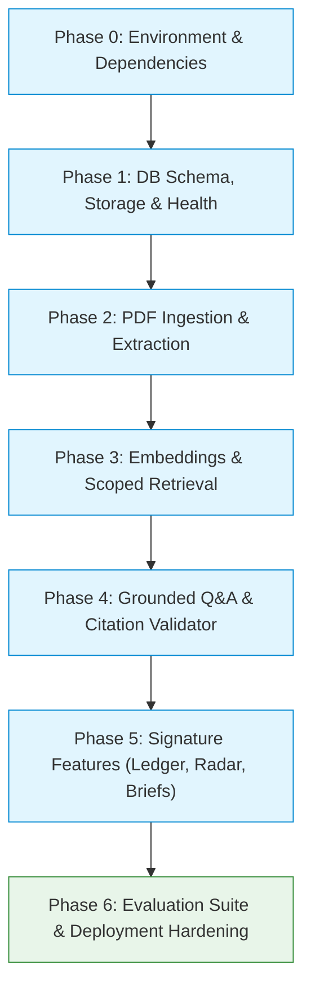

# ProofLens AI — Implementation Plan

## 1. Delivery Strategy

ProofLens AI follows a strict **Dependency-First, Evidence-First** delivery methodology. Rather than attempting a broad horizontal sweep or building the user interface ahead of data reliability, each layer is implemented and verified vertically:

```
[Storage & Schema Foundation]
             ↓
[Page-Aware Extraction & Chunking]
             ↓
[Vector Embeddings & Scoped Retrieval]
             ↓
[Grounded Q&A & Citation Validation]
             ↓
[Signature Features: Ledger, Radar, Briefs]
             ↓
[Trust Benchmark & Evaluation Suite]
             ↓
[Production Hardening & Deployment]
```

### Core Principles:
1. **Vertical Slices:** Every phase introduces concrete models, services, endpoints, and automated tests.
2. **Never Build UI Before Verified Core:** The frontend relies on strict, verified backend contracts and server-side citation integrity.
3. **No Over-Engineering:** Direct Python implementation without LangChain, LangGraph, agents, or external vector stores.
4. **Git Discipline:** Commit and push to version control after completing each milestone.

---

## 2. Phased Implementation Roadmap

### Phase 0: Repository & Environment Readiness
- Establish clean workspace structure and root `.gitignore`.
- Set up isolated Python 3.13 virtual environment (`backend/venv`).
- Configure dependency manifests (`requirements.txt`).
- Establish Pydantic configuration (`app/core/config.py`) and `.env.example`.
- Ensure strictly **no Docker** requirement for local development.

### Phase 1: Application Foundation & Database Schema
- Establish FastAPI application factory, middleware, CORS, and request ID tracking.
- Set up SQLAlchemy 2.0 DeclarativeBase, session lifecycle, and database connection.
- Implement storage abstraction: `LocalStorageService` (native filesystem) and `SupabaseStorageService` (remote cloud).
- Implement Alembic migration configuration with dynamic `pgvector` detection.
- Add `/health` (liveness) and `/ready` (database connectivity) endpoints.
- Add unit tests for configuration, health routes, models, and storage.

### Phase 2: Document Ingestion & Page-Aware Extraction
- Implement multi-part PDF upload endpoint (`POST /api/v1/workspaces/{id}/documents`).
- Integrate PyMuPDF (`fitz`) for extraction with page-level provenance.
- Handle unreadable/empty PDFs and corrupt headers gracefully with descriptive error statuses.
- Implement deterministic sliding-window chunking (target: 500 chars, 100 overlap) respecting page boundaries.
- Implement cascading deletion (`DELETE /api/v1/documents/{id}` and `DELETE /api/v1/workspaces/{id}`).
- Add integration tests for end-to-end PDF processing and file storage.

### Phase 3: Embeddings & Scoped Retrieval
- Integrate Google GenAI SDK (`google-genai`) for `text-embedding-004` (768 dimensions).
- Implement batch chunk embedding generation.
- Implement hybrid retrieval service: native pgvector HNSW search with dynamic fallback to Python cosine similarity when running on local Windows setups without native `vector.dll`.
- Expose scoped vector retrieval endpoint (`POST /api/v1/workspaces/{id}/retrieve`).
- Add tests validating document scoping and cosine similarity ranking.

### Phase 4: Grounded Q&A, Citation Validation & Abstention
- Implement grounded synthesis prompt with anti-prompt injection delimiters.
- Implement server-side citation validation engine: verifying that returned citations match actual retrieved chunks and pages.
- Enforce explicit abstention (`status: "insufficient_evidence"`) when no relevant evidence exists.
- Implement `/api/v1/workspaces/{id}/ask` endpoint storing queries, answers, and citation links.
- Add integration tests verifying citation validation, stripping hallucinated citations, and abstention behavior.

### Phase 5: Signature Intelligence Features
- **Claim Evidence Ledger (`POST .../claims/assess`):** Decomposes inputs into discrete claims and assesses each against 4 statuses: `supported`, `partially_supported`, `contradicted`, and `insufficient_evidence`.
- **Contradiction Radar (`POST .../compare`):** Compares 2+ documents on a given topic, extracting conflicting viewpoints with dual-sided citations while accounting for dates and scope.
- **Research Brief Generator (`POST .../briefs`):** Synthesizes multi-document findings into an executive brief with citations, limitations, and clean Markdown export (`GET .../briefs/{id}/markdown`).
- Add integration tests covering all three signature capabilities.

### Phase 6: Trust, Evaluation & Deployment Hardening
- Create curated benchmark dataset (`backend/evals/cases.json`) with ground-truth evidence targets and expected behaviors.
- Implement standalone evaluation runner CLI (`backend/evals/run_eval.py`).
- Implement `/api/v1/evaluation/run` and `/api/v1/evaluation/summary` endpoints.
- Configure deployment specification (`backend/render.yaml`) and production instructions.
- Ensure 100% test suite pass rate with comprehensive test coverage.

---

## 3. Phase Dependency Graph



---

## 4. Acceptance Criteria by Phase

| Phase | Core Deliverable | Objective Acceptance Criteria |
|---|---|---|
| **0** | Environment | Python virtual environment active, dependencies installed, `.env.example` created. |
| **1** | Foundation | `/health` returns 200 `ok`, `/ready` verifies database connectivity, Alembic migrations apply cleanly. |
| **2** | Ingestion | PDF uploaded, text extracted page-by-page, chunks generated with provenance, invalid files rejected. |
| **3** | Retrieval | Chunks embedded into 768-dim vectors, scoped search returns top-$K$ matches with similarity scores. |
| **4** | Q&A | Model generates grounded answers, server-side validation strips ungrounded citations, abstains when evidence is missing. |
| **5** | Features | Claim ledger evaluates claims with 4 statuses; Contradiction Radar detects conflicts across $\ge 2$ docs; Brief exports to Markdown. |
| **6** | Evaluation | Benchmark runner executes test cases, calculates hit rate ($\ge 80\%$) and citation validity ($\ge 95\%$), full test suite passes. |

---

## 5. Day-by-Day Implementation Schedule (2–3 Day MVP)

### Day 1: Foundation, Ingestion & Retrieval
- **Morning:** Initialize repo, configure environment, build database models, Alembic migrations, and health checks.
- **Afternoon:** Implement PyMuPDF extraction, chunking, and storage service.
- **Evening:** Build embedding generation and scoped vector retrieval. Verify with unit tests.

### Day 2: Grounded Q&A & Signature Features
- **Morning:** Build Grounded Q&A pipeline with strict citation validation and abstention.
- **Afternoon:** Implement Claim Evidence Ledger and Contradiction Radar.
- **Evening:** Implement Research Brief Generator and Markdown export. Run integration test suite.

### Day 3: Evaluation, Hardening & Deployment
- **Morning:** Build curated evaluation cases (`cases.json`) and evaluation runner CLI.
- **Afternoon:** Validate local PostgreSQL database connectivity and apply production Supabase credentials.
- **Evening:** Finalize Render deployment configuration, execute smoke tests, verify README documentation.

---

## 6. Risks & Mitigations

| Risk | Impact | Mitigation Strategy |
|---|---|---|
| **Local Windows missing `vector.dll`** | High | Dynamic schema detection: falls back to `JSON` vector storage and fast in-memory cosine similarity locally, while preserving native `Vector(768)` on Supabase in production. |
| **LLM Citation Hallucination** | High | Server-side citation verification checks all cited chunk IDs against retrieved evidence, silently stripping invalid references before returning responses. |
| **Gemini API Rate Limiting** | Medium | Bounded retries with exponential backoff, batch chunk embedding calls, and defensive timeout handling. |
| **Prompt Injection in PDFs** | High | Treat PDF text strictly as untrusted data within `<source_evidence>` XML boundaries; explicitly forbid system prompt overrides. |
| **Cold Starts on Free Hosting** | Medium | `/health` liveness endpoint for keep-alive monitoring and clear status reporting in UI during initial wake-up. |

---

## 7. Final Definition of Done (DoD)

An MVP milestone is considered **Done** only when:
1. All database migrations execute cleanly on both local PostgreSQL and production Supabase.
2. All 6 MVP capabilities are functional with documented REST endpoints.
3. Automated test suite passes 100% of unit and integration tests.
4. Evaluation runner reports $\ge 80\%$ retrieval hit rate and $\ge 95\%$ citation validity.
5. All code, migrations, and documentation are committed and pushed to GitHub main branch.
