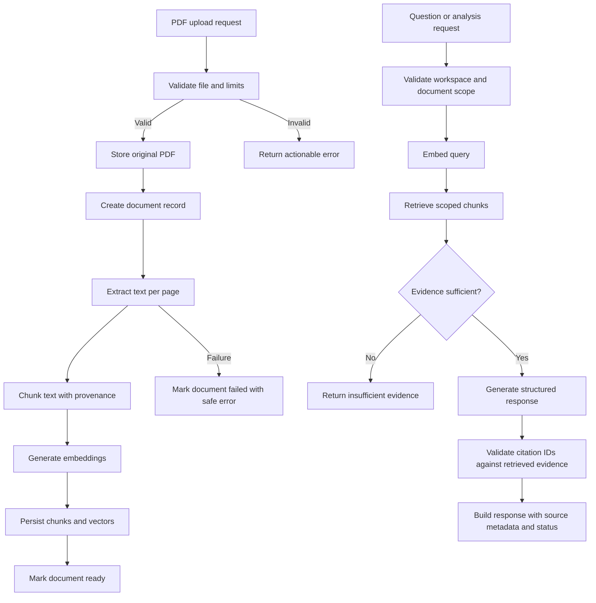

# ProofLens AI — Software Requirements Specification (SRS)

**Document ID:** PLAI-SRS-001  
**Version:** 1.0  
**Status:** Draft for owner review  
**Product:** ProofLens AI — From Documents to Verifiable Answers  
**Specification focus:** Backend-first MVP  
**Source baseline:** `ProofLens-AI-Project-Kickoff-PRD-v0.1.md` and the approved six-feature MVP scope  
**Implementation constraint:** Build and validate the backend before starting frontend implementation; target a working demo within 2–3 days using free-tier services where feasible.

---

## 1. Purpose

This SRS defines the functional, data, interface, quality, security, and testing requirements for the ProofLens AI backend. It is intended to be the implementation contract for the backend work in Google Antigravity.

ProofLens AI is an evidence-first document intelligence system. It lets users ingest a bounded collection of PDF documents, ask questions across those documents, inspect page-level evidence, review claims, compare documents, create research briefs, and run a repeatable evaluation suite.

The system must prioritize **evidence before confidence**. A generated answer is not automatically verified truth. The backend must preserve source provenance, validate citation references, disclose insufficient evidence, and avoid inventing claims or contradictions.

This is a technical SRS, not a frontend design specification. Frontend screens and visual styling are explicitly deferred. The backend must expose documented APIs that a future Next.js frontend can consume.

## 2. Scope

### 2.1 In-scope MVP capabilities

1. **Smart Document Library API:** Create/manage a workspace, upload multiple PDFs, list documents and processing states, inspect document metadata, and delete documents.
2. **Evidence-First AI Assistant API:** Retrieve semantically relevant passages from an explicit workspace/document scope; generate grounded answers; validate page-level citations; abstain when evidence is inadequate.
3. **Claim Evidence Ledger API:** Produce claim-level classifications of `supported`, `partially_supported`, `contradicted`, or `insufficient_evidence`, with source passages and uncertainty. These are model-assisted assessments, not objective truth.
4. **Contradiction Radar API:** Compare a topic across at least two selected documents, return findings and evidence per source, and identify agreement, differences, or apparent contradictions only when supported.
5. **Research Brief Generator API:** Produce a structured brief with summary, findings, citations, disagreements, and limitations. Export Markdown. PDF export may be deferred to browser print-to-PDF in a later frontend.
6. **Trust & Evaluation API/CLI:** Run a curated evaluation set and report retrieval hit rate, citation validity, abstention behaviour, latency, and provider errors where measurable. Never fabricate metrics.

All six features must reuse the same ingestion, provenance, retrieval, and evidence-validation pipeline. Do not implement six unrelated AI pipelines.

### 2.2 Explicitly out of scope for this MVP

- Frontend pages, visual design, animations, and client-side state management.
- Autonomous agents, multi-agent orchestration, LangGraph, MCP, or agent frameworks.
- OCR for scanned PDFs; scanned/image-only PDFs may be rejected with a useful error.
- Unrestricted web search or real-time internet research.
- Guaranteed truth detection or claims of infallible verification.
- Fine-tuning or training a foundation model.
- Enterprise SSO, billing, complex multi-tenant SaaS administration, or collaboration.
- Support for every file type or language.
- Advanced table/numerical analysis, a graph explorer, or automatic claim re-verification.
- A dedicated background queue unless measured processing time and the approved limits justify one.

### 2.3 Supported input

- Text-based PDF files only.
- Text encoding and PDF extraction quality may vary. Empty, encrypted, corrupted, unsupported, or image-only PDFs must produce explicit failure states rather than silent success.
- File-size, page-count, workspace document-count, extracted-text, chunk-count, and retrieval limits must be configurable. Concrete limits must be selected before implementation and documented in configuration.

## 3. Normative language

The words **MUST**, **MUST NOT**, **SHOULD**, and **MAY** indicate requirement priority. A MUST requirement is required for MVP acceptance. A SHOULD requirement may be deferred only with an explicit documented reason.

## 4. Users and operating assumptions

### 4.1 Primary users

- Students preparing project reports and presentations.
- Researchers reviewing a small collection of papers or reports.
- Developers and project teams comparing technical documents.

### 4.2 Initial deployment assumptions

- The application is a college/portfolio demonstration, not a production high-stakes decision system.
- Backend implementation is the first development stage; the frontend will be built later against the API contract.
- Use a single private demo workspace or simple workspace ownership model unless owner approval requires authentication. Do not imply authorization exists if it has not been implemented.
- Use PostgreSQL with pgvector for application metadata and embeddings, and Supabase Storage for persistent uploaded files in the hosted demo. Local development must support a documented storage configuration.
- Use direct provider SDK/API calls behind a small adapter interface. Gemini is the planned LLM/embedding provider, but exact model identifiers and availability must be verified before configuration is finalized.
- Free-tier limits, provider quotas, cold starts, and persistence limitations must be documented. Free hosting is suitable for a demo, not a promise of production uptime.

## 5. System architecture requirements

### 5.1 Required stack

| Layer | Requirement |
|---|---|
| API framework | Python + FastAPI |
| Request/response validation | Pydantic |
| PDF text extraction | PyMuPDF |
| Relational data | PostgreSQL |
| Vector search | pgvector, after compatibility validation |
| Database access | SQLAlchemy with migrations |
| LLM and embeddings | Gemini API through a small provider adapter; verify model availability |
| Uploaded file persistence | Supabase Storage for hosted deployment; local storage adapter for development |
| Automated tests | Pytest; HTTPX for API integration tests |
| API documentation | FastAPI-generated OpenAPI/Swagger UI |
| Frontend | Not implemented in this stage; future Next.js client consumes REST API |

Do not add LangChain, LangGraph, MCP, Redis, a separate vector database, message brokers, or additional infrastructure without demonstrating a concrete requirement.

### 5.2 Logical components

1. **API layer:** Routes, authentication/authorization hooks if applicable, request validation, response serialization, and consistent error mapping.
2. **Application/service layer:** Workspace, document lifecycle, ingestion orchestration, Q&A, claim assessment, comparison, brief generation, and evaluation use cases.
3. **Document pipeline:** Upload validation, file storage, PDF extraction, page preservation, chunking, embedding, and indexing.
4. **Retrieval service:** Query embedding, workspace/document scope filters, vector similarity search, threshold handling, and ranked evidence assembly.
5. **Evidence and answer service:** Structured model calls, evidence sufficiency decision, citation reference validation, abstention, and response construction.
6. **Provider adapter:** Small, typed interface for generation and embeddings; provider-specific implementation and model names remain configurable.
7. **Persistence layer:** SQLAlchemy models/repositories, PostgreSQL/pgvector, migration scripts, and storage metadata.
8. **Evaluation module:** Version-controlled evaluation cases, deterministic metrics where possible, model-based judgements clearly labelled, and a reproducible CLI/API entry point.

### 5.3 Request flow



### 5.4 Design rules

- API routes MUST remain thin; business logic belongs in service modules.
- Retrieval MUST be independently testable from answer generation.
- Provider-specific calls MUST be isolated behind an adapter.
- Long-running processing MUST expose status. Start with a simple synchronous/background-task approach appropriate to the selected limits; introduce a queue only if justified.
- Database migrations MUST be committed with schema changes.
- File storage and vector storage MUST be persistent in hosted deployment. Do not rely on ephemeral backend filesystem storage for uploaded files.
- Do not log full document content, full prompts containing source text, API keys, or other sensitive content by default.

## 6. Functional requirements

### FR-01 — Workspace and document lifecycle

**Priority:** MUST

- FR-01.1: The backend MUST provide a stable workspace identifier and enforce workspace/document scope on every operation.
- FR-01.2: The backend MUST accept multiple PDF uploads within configured limits.
- FR-01.3: It MUST validate extension, MIME/content signature where practical, file size, page count, and parseability. A filename extension alone is not sufficient validation.
- FR-01.4: It MUST persist document name, file size, upload time, status, page count when available, storage key, and stable ID.
- FR-01.5: It MUST expose document statuses such as `uploaded`, `processing`, `ready`, and `failed`, plus a safe failure reason.
- FR-01.6: Duplicate uploads and retried ingestion MUST be handled predictably; retries MUST NOT create duplicate chunks or embeddings for the same processing version.
- FR-01.7: Deleting a document MUST remove or schedule removal of its original file, extracted pages, chunks, embeddings, and dependent records where appropriate. Partial deletion failures MUST be observable and retryable.
- FR-01.8: The backend MUST reject operations on documents outside the caller's authorized workspace scope.

### FR-02 — PDF extraction and provenance

**Priority:** MUST

- FR-02.1: Extract text page by page using PyMuPDF.
- FR-02.2: Preserve 1-based human-readable page numbers and internal page identity through chunking, retrieval, generation, and response.
- FR-02.3: Preserve document ID, page number, chunk index, extraction/processing version, and character offsets where reliably available.
- FR-02.4: Detect empty, encrypted, corrupted, and unsupported/image-only PDFs and mark ingestion failed with a useful reason.
- FR-02.5: Keep source text separate from AI-generated interpretations in storage and API responses.
- FR-02.6: Extraction output MUST be deterministic for a fixed file and parser configuration as far as the parser permits.

### FR-03 — Chunking and embeddings

**Priority:** MUST

- FR-03.1: Split extracted page text into bounded chunks using configurable chunk size and overlap.
- FR-03.2: Preserve page provenance for every chunk. If a chunk spans pages, store explicit page-span metadata; prefer page-bounded chunks for simpler, reliable citations.
- FR-03.3: Generate embeddings using the configured embedding provider/model.
- FR-03.4: Store vectors and metadata in PostgreSQL/pgvector after verifying extension, dimensions, and hosted compatibility.
- FR-03.5: Store an embedding model/version identifier so vectors can be invalidated and regenerated when configuration changes.
- FR-03.6: Handle provider errors with timeouts and bounded retries; do not mark a document `ready` if required indexing failed.
- FR-03.7: Configure limits to bound chunk counts, embedding calls, latency, and cost.

### FR-04 — Semantic retrieval

**Priority:** MUST

- FR-04.1: Embed a query and retrieve relevant chunks from the requested workspace and optional document subset only.
- FR-04.2: Every retrieved result MUST include server-derived document ID/name, page number or page span, chunk ID, excerpt, and similarity/distance metadata where meaningful.
- FR-04.3: Retrieval count (`top_k`) and any similarity threshold MUST be configurable.
- FR-04.4: Retrieval MUST reject or safely handle queries whose scope includes no ready documents.
- FR-04.5: Similarity is a ranking signal, not proof that a passage supports a claim.
- FR-04.6: Provide an independently testable retrieval service and a repeatable evaluation set for source retrieval.

### FR-05 — Evidence-first Q&A and citation validation

**Priority:** MUST

- FR-05.1: Document-specific answers MUST be grounded only in evidence retrieved from the requested document scope.
- FR-05.2: The model MUST return a structured result that identifies answer text, evidence references, and uncertainty/status fields.
- FR-05.3: The backend MUST validate every cited evidence ID against the actual retrieved evidence set for that request.
- FR-05.4: Document IDs, names, page numbers, and excerpts MUST be derived from stored source records, not trusted from model-generated metadata.
- FR-05.5: Invalid citation references MUST be removed or cause the answer to be downgraded/rejected; invalid citations MUST NOT be silently displayed as valid.
- FR-05.6: If evidence is missing, weak, or materially conflicting, the system MUST return `insufficient_evidence` or an equivalent explicit uncertainty status rather than inventing an answer.
- FR-05.7: A response MUST include source citations and supporting excerpts where evidence exists.
- FR-05.8: Keep retrieved evidence available to tests and evaluation without unsafe default logging.
- FR-05.9: Treat document contents as untrusted data. Instructions inside PDFs MUST NOT override system instructions or authorize tool execution.

### FR-06 — Claim Evidence Ledger

**Priority:** MUST for MVP feature demonstration

- FR-06.1: Given a question, generated answer, or a bounded set of extracted claims, return claim-level assessments.
- FR-06.2: Each claim MUST use one status from `supported`, `partially_supported`, `contradicted`, or `insufficient_evidence`.
- FR-06.3: Each assessment MUST include claim text, status, evidence references, a concise rationale, and an uncertainty/limitations field.
- FR-06.4: A `supported` status MUST require one or more validated evidence references that materially support the claim.
- FR-06.5: A `contradicted` status MUST require evidence that directly conflicts with the claim; absence of support alone is not contradiction.
- FR-06.6: `partially_supported` MUST distinguish supported subclaims from unsupported portions where practical.
- FR-06.7: Labels MUST be described as model-assisted evidence assessments, not definitive truth judgements.
- FR-06.8: Every evidence reference MUST pass the same server-side citation validation used by Q&A.

### FR-07 — Contradiction Radar / cross-document comparison

**Priority:** MUST

- FR-07.1: Accept a topic or question and at least two selected ready documents within the permitted workspace.
- FR-07.2: Retrieve evidence independently for each selected document, avoiding accidental scope leakage.
- FR-07.3: Return per-document findings with validated source references.
- FR-07.4: Classify the relationship as `agreement`, `difference`, `apparent_contradiction`, or `inconclusive` where appropriate.
- FR-07.5: Do not force a contradiction when documents differ in date, scope, definitions, population, assumptions, or methodology. Surface such limitations.
- FR-07.6: Every comparison result MUST include a concise rationale and source evidence from each side where available.
- FR-07.7: If one document has no relevant evidence, explicitly mark that limitation rather than manufacturing a balanced comparison.

### FR-08 — Research Brief Generator

**Priority:** MUST for Markdown brief generation

- FR-08.1: Generate a structured research brief from an explicit workspace/document scope and topic or question.
- FR-08.2: The brief MUST support sections for executive summary, key findings, evidence/citations, agreements and disagreements, limitations, and unresolved questions when relevant.
- FR-08.3: Every factual finding derived from source documents MUST include validated citations.
- FR-08.4: The brief MUST state when the supplied documents do not establish a conclusion.
- FR-08.5: Provide Markdown export with stable citation references and human-readable document/page labels.
- FR-08.6: PDF generation is not required in the backend-first MVP; a later frontend may use browser print-to-PDF.

### FR-09 — Trust and evaluation

**Priority:** MUST

- FR-09.1: Maintain a small, version-controlled evaluation dataset with questions, expected source documents/pages or evidence, expected answer characteristics, and selected unsupported questions.
- FR-09.2: Measure retrieval hit rate on the curated set.
- FR-09.3: Measure citation validity: proportion of returned citation references that map to real retrieved source locations.
- FR-09.4: Evaluate abstention on selected questions where the source collection lacks supporting evidence.
- FR-09.5: Report latency and provider errors when measured. Include sample count and test configuration.
- FR-09.6: Label LLM-judged metrics as model-based evaluation; do not describe them as ground truth.
- FR-09.7: Provide a reproducible CLI command and/or protected API operation to run the evaluation suite.
- FR-09.8: Do not fabricate dashboard metrics or present empty/unrun evaluations as successful.

### FR-10 — Operational and API behaviour

**Priority:** MUST

- FR-10.1: Validate all request payloads and return stable error shapes.
- FR-10.2: Set timeouts and bounded retries for external provider calls.
- FR-10.3: Return useful errors without leaking stack traces, secrets, raw provider payloads, or sensitive document content.
- FR-10.4: Track request duration and provider usage/token information when available and safe.
- FR-10.5: Expose a health endpoint that distinguishes basic API health from dependency readiness where practical.
- FR-10.6: Configure CORS explicitly for approved frontend origins when the frontend is introduced; do not use unrestricted production CORS.
- FR-10.7: Keep provider keys server-side only.

## 7. REST API specification

All endpoints are versioned under `/api/v1`. FastAPI OpenAPI output is the canonical machine-readable API description. Exact implementation names may change only if the contract remains equivalent and is documented.

### 7.1 Common conventions

- Content type: `application/json`, except PDF upload (`multipart/form-data`) and Markdown export (`text/markdown`).
- IDs: UUIDs or another consistently documented opaque identifier.
- Timestamps: ISO 8601 UTC.
- Page numbers: 1-based.
- Long-running document ingestion returns promptly with a document ID and status; clients poll status.
- All endpoints must enforce workspace/document scope.
- Standard error response:

```json
{
  "error": {
    "code": "DOCUMENT_NOT_READY",
    "message": "The selected document is not ready for querying.",
    "request_id": "req_example",
    "details": {}
  }
}
```

### 7.2 Health and configuration

| Method | Endpoint | Purpose |
|---|---|---|
| GET | `/health` | Liveness/basic API health |
| GET | `/ready` | Readiness including required database/storage dependencies where practical |

Do not return secrets, full environment variables, or provider credentials in health responses.

### 7.3 Workspace and documents

| Method | Endpoint | Purpose |
|---|---|---|
| POST | `/api/v1/workspaces` | Create workspace |
| GET | `/api/v1/workspaces` | List permitted workspaces |
| GET | `/api/v1/workspaces/{workspace_id}` | Get workspace metadata |
| POST | `/api/v1/workspaces/{workspace_id}/documents` | Upload PDF (`multipart/form-data`) |
| GET | `/api/v1/workspaces/{workspace_id}/documents` | List documents and statuses |
| GET | `/api/v1/workspaces/{workspace_id}/documents/{document_id}` | Get document metadata/status |
| GET | `/api/v1/workspaces/{workspace_id}/documents/{document_id}/pages/{page_number}` | Get extracted page text if authorized |
| DELETE | `/api/v1/workspaces/{workspace_id}/documents/{document_id}` | Delete document and associated indexed data |

**Upload response example:**

```json
{
  "document_id": "uuid",
  "workspace_id": "uuid",
  "filename": "report.pdf",
  "status": "processing",
  "uploaded_at": "2026-10-12T12:00:00Z"
}
```

**Document status response example:**

```json
{
  "document_id": "uuid",
  "filename": "report.pdf",
  "status": "ready",
  "page_count": 24,
  "chunk_count": 68,
  "error_code": null,
  "error_message": null
}
```

### 7.4 Retrieval and Q&A

| Method | Endpoint | Purpose |
|---|---|---|
| POST | `/api/v1/workspaces/{workspace_id}/retrieve` | Retrieve evidence without answer generation |
| POST | `/api/v1/workspaces/{workspace_id}/ask` | Evidence-grounded question answering |

**Ask request example:**

```json
{
  "question": "What delivery risks are identified in the reports?",
  "document_ids": ["uuid-a", "uuid-b"],
  "top_k": 6
}
```

**Ask response example:**

```json
{
  "query_id": "uuid",
  "status": "answered",
  "answer": "The reports identify supplier delays and limited inventory visibility.",
  "citations": [
    {
      "citation_id": "cit-1",
      "document_id": "uuid-a",
      "document_name": "operations-report.pdf",
      "page_number": 7,
      "chunk_id": "uuid-chunk",
      "excerpt": "Supplier lead times increased during the reporting period."
    }
  ],
  "limitations": [],
  "model_metadata": {
    "provider": "configured-provider",
    "model": "configured-model"
  }
}
```

`status` MUST support at least `answered` and `insufficient_evidence`. Model metadata MUST omit credentials and may omit provider/model names if exposing them is not desired. Citation metadata must be populated by the server.

### 7.5 Claim Evidence Ledger

| Method | Endpoint | Purpose |
|---|---|---|
| POST | `/api/v1/workspaces/{workspace_id}/claims/assess` | Assess claims against scoped documents |

Request fields: `claims` or a source `question`/`answer`, `document_ids`, and optional bounded retrieval settings.

Response claim fields:

```json
{
  "claim_id": "claim-1",
  "claim_text": "Supplier lead times increased.",
  "status": "supported",
  "rationale": "The cited report explicitly states that lead times increased.",
  "citations": [
    {
      "document_id": "uuid-a",
      "document_name": "operations-report.pdf",
      "page_number": 7,
      "chunk_id": "uuid-chunk",
      "excerpt": "Supplier lead times increased during the reporting period."
    }
  ],
  "limitations": []
}
```

### 7.6 Contradiction Radar

| Method | Endpoint | Purpose |
|---|---|---|
| POST | `/api/v1/workspaces/{workspace_id}/compare` | Compare a topic across selected documents |

Requirements: minimum two distinct ready documents; explicit document scope; evidence returned per document; comparison relationship from the approved enum; limitations for scope/date/definition/methodology mismatches.

### 7.7 Research Briefs

| Method | Endpoint | Purpose |
|---|---|---|
| POST | `/api/v1/workspaces/{workspace_id}/briefs` | Generate structured brief |
| GET | `/api/v1/workspaces/{workspace_id}/briefs/{brief_id}` | Retrieve persisted brief if persistence is implemented |
| GET | `/api/v1/workspaces/{workspace_id}/briefs/{brief_id}/markdown` | Export Markdown |

If time constraints require brief persistence to be deferred, the generation endpoint may return Markdown directly, but this deviation must be documented.

### 7.8 Evaluation

| Method | Endpoint | Purpose |
|---|---|---|
| GET | `/api/v1/evaluation/summary` | Retrieve latest evaluation summary if available |
| POST | `/api/v1/evaluation/run` | Run curated suite only in an authorized development/demo context |

The CLI is the preferred first implementation path for evaluation if exposing a run endpoint would introduce unnecessary security or runtime complexity.

## 8. Data model requirements

The following is the minimum logical schema. Final SQL types and constraints must be documented in migrations.

| Entity | Key fields | Purpose |
|---|---|---|
| `workspaces` | `id`, `name`, `created_at`, optional `owner_id` | Groups documents and analysis scope |
| `documents` | `id`, `workspace_id`, `filename`, `storage_key`, `size_bytes`, `status`, `page_count`, `checksum`, `error_code`, timestamps | Source-file identity and lifecycle |
| `document_pages` | `id`, `document_id`, `page_number`, `text`, `text_hash`, extraction version | Page-level extracted source text |
| `document_chunks` | `id`, `document_id`, `page_number` or page-span metadata, `chunk_index`, `text`, offsets, embedding model/version, vector | Retrieval units with provenance |
| `query_runs` | `id`, `workspace_id`, question, selected scope, status, latency, created_at | Auditable Q&A request metadata without unnecessary raw-content logging |
| `retrieved_evidence` | `id`, `query_run_id`, `chunk_id`, rank, similarity/distance | Evidence actually used by a request |
| `answers` | `id`, `query_run_id`, answer text, status, limitations, model metadata | Generated answer result |
| `citations` | `id`, `answer_id` or analysis result ID, `chunk_id`, citation order | Server-validated links to source evidence |
| `analysis_runs` | `id`, `workspace_id`, type, input scope, status, result JSON, timestamps | Claim assessment, comparison, and brief outputs if persistence is required |
| `evaluation_cases` | `id`, case key, question, expected evidence, expected behaviour, tags | Versioned evaluation data |
| `evaluation_runs` | `id`, config/version, metrics JSON, sample count, started/finished timestamps | Reproducible evaluation results |

### 8.1 Data integrity constraints

- Document IDs MUST be unique and belong to one workspace.
- Page numbers MUST be positive and unique per document.
- Chunk IDs MUST be stable for a specific document processing version.
- Vector dimensions MUST match the configured embedding model.
- Citations MUST reference existing chunks belonging to the same workspace/document scope as the analysis.
- Deleting a document MUST cascade or explicitly clean up dependent pages, chunks, vectors, citations, and analysis references according to a documented policy.
- Database queries MUST be parameterized through the selected ORM/database layer.
- Store checksums to identify exact-file duplicates where practical; duplicate handling must not accidentally merge distinct documents with the same filename.

## 9. Evidence, prompting, and AI reliability

### 9.1 Structured model outputs

- Use Pydantic models to validate model output.
- The model may suggest evidence IDs only from the evidence IDs provided in its request context.
- The backend MUST validate all evidence IDs after generation.
- Parse failures must trigger a bounded repair attempt or a safe error/abstention response, not an unvalidated fallback.
- Keep prompts in dedicated modules or template files, separate from route handlers.

### 9.2 Evidence sufficiency

Sufficiency must be based on retrieved relevance, coverage, conflicts, and task type—not solely on the model's confidence language. Thresholds are configurable and must be calibrated against the curated evaluation set. If the system cannot establish adequate support, it must abstain.

### 9.3 Prompt-injection resistance

- Treat every PDF passage as untrusted data, not executable instructions.
- Explicitly instruct the model to answer the user's task using source material as evidence only.
- Do not give the model tools or arbitrary action capabilities in this MVP.
- Do not let document text change authorization, provider settings, system policy, or data scope.
- Add adversarial evaluation cases that contain instructions such as “ignore previous instructions” inside a document.

### 9.4 Citation validity

- Citations are references to source passages, not proof that the interpretation is correct.
- Derive filenames and page numbers from stored records.
- Reject citations that refer to nonexistent or non-retrieved chunks.
- Include the original excerpt so users can inspect context.
- Preserve page numbering as shown by the PDF reader (1-based), and document any parser edge cases.

## 10. Non-functional requirements

### 10.1 Security and privacy

- Secrets MUST be loaded from environment variables or a secret manager and MUST NOT be committed or returned to clients.
- Uploaded content MUST be treated as untrusted.
- Validate file content, size, and payloads.
- Enforce workspace authorization server-side if authentication/ownership is enabled.
- Avoid logging document text, complete prompts, or personally sensitive content by default.
- Avoid exposing raw stack traces or raw provider errors to API clients.
- Define deletion behaviour for originals, page text, chunks, embeddings, and analysis artifacts.
- Use TLS for hosted service communication and restrictive CORS when a browser client is added.
- Do not claim authentication or multi-user isolation unless implemented and tested.

### 10.2 Reliability

- Use provider timeouts and bounded retries with backoff where appropriate.
- Handle partial ingestion failure and expose processing status.
- Make ingestion retries idempotent.
- Return clear errors for quota exhaustion, provider outages, and unavailable database/storage services.
- Do not mark processing complete until required extraction, embedding, and indexing steps succeed.

### 10.3 Maintainability

- Use typed request/response schemas and clear module boundaries.
- Centralize settings and limits.
- Use database migrations.
- Keep provider integration replaceable.
- Document local setup, configuration, migrations, test execution, evaluation execution, and deployment assumptions.

### 10.4 Performance and cost

- Set explicit maximums for upload size, page count, documents per workspace, chunk count, query length, retrieved chunks, and generation output.
- Measure latency before optimizing.
- Cache or reuse embeddings for unchanged document processing versions where practical.
- Avoid unnecessary repeated embedding calls.
- Do not claim a latency SLA until environment and document sizes are specified.
- Document provider quotas and free-tier restrictions.

### 10.5 Accessibility and usability support

Although frontend work is deferred, API states must support clear client feedback: processing, ready, failed, answered, insufficient evidence, conflict, and provider error. API messages must be human-readable and stable enough for a future client to map to UI states.

## 11. Error handling

Use stable error codes and appropriate HTTP status codes.

| Condition | Suggested HTTP status | Example code |
|---|---:|---|
| Invalid request | 422 | `VALIDATION_ERROR` |
| Missing workspace/document | 404 | `RESOURCE_NOT_FOUND` |
| Unsupported file | 415 | `UNSUPPORTED_FILE_TYPE` |
| File/page/size limit exceeded | 413 | `FILE_LIMIT_EXCEEDED` |
| Document still processing | 409 | `DOCUMENT_NOT_READY` |
| No relevant evidence | 200 with explicit result status | `INSUFFICIENT_EVIDENCE` |
| Provider quota/rate limit | 503 or documented mapping | `PROVIDER_UNAVAILABLE` |
| Provider timeout | 504 | `PROVIDER_TIMEOUT` |
| Internal unexpected failure | 500 | `INTERNAL_ERROR` |

The API MUST NOT return a fabricated answer as a substitute for an error or insufficient-evidence state.

## 12. Testing requirements

### 12.1 Unit tests

- PDF extraction and page numbering.
- Chunk boundaries and page provenance.
- Chunk idempotency and processing-version handling.
- Embedding vector dimension validation.
- Workspace/document scope filters.
- Citation reference validation.
- Evidence sufficiency and abstention rules.
- Claim classification schema validation.
- Comparison status and limitation handling.
- Markdown citation formatting.
- Deletion/cascade logic.
- Error mapping and secret redaction.

### 12.2 Integration tests

- Upload a sample PDF, process it, and retrieve document status.
- Verify extracted page text and chunk provenance.
- Retrieve expected evidence from a known query.
- Ask a supported question and verify that every citation maps to retrieved evidence.
- Ask an unsupported question and verify explicit abstention.
- Compare two documents and verify per-document evidence.
- Delete a document and verify its file/indexed data is removed or deletion is reported as pending/failed.
- Verify cross-workspace access is rejected if workspace ownership/auth is enabled.
- Test provider timeout, quota error, and malformed model output handling.

### 12.3 Evaluation dataset and metrics

- Store a small, curated dataset in version control.
- Include answerable questions, unsupported questions, cross-document comparisons, and prompt-injection examples.
- Report retrieval hit rate, citation validity, abstention success, latency, provider error counts, and sample count where applicable.
- Define each metric and its denominator.
- Clearly distinguish deterministic checks from LLM-based judgements.
- Provide a single documented command to run the suite.

### 12.4 MVP test exit criteria

- All critical unit tests pass.
- Core ingestion, retrieval, citation, and abstention integration paths pass.
- Unsupported questions produce explicit insufficient-evidence results.
- All returned citations resolve to real stored source locations.
- Evaluation output is reproducible and includes limitations.
- No secrets are present in tracked files or API responses.

## 13. Backend-first implementation sequence

The following order is intended to fit a 2–3 day prototype window. It is a delivery plan, not permission to skip review or report unrun tests as passing.

### Phase 0 — Confirm environment and decisions

- Inspect repository, `AGENTS.md`, README, existing code, runtime versions, and Git state.
- Confirm Python version and dependency compatibility.
- Verify Gemini generation and embedding model availability, vector dimensions, pgvector compatibility, and free-tier constraints.
- Confirm local/hosted database and storage configuration.
- Record unresolved decisions; do not silently invent credentials or claim external services are configured.

**Exit:** approved backend design and documented configuration requirements.

### Phase 1 — Backend skeleton and persistence

- Create FastAPI app, settings, health/readiness endpoints, error schemas, SQLAlchemy setup, migrations, and test configuration.
- Implement workspace/document metadata models and storage abstraction.
- Verify a clean local startup and database migration.

**Exit:** health endpoints and persistence tests pass.

### Phase 2 — PDF ingestion and provenance

- Implement upload validation, storage, PDF extraction, page records, chunking, status transitions, and deletion.
- Add idempotent processing behaviour and tests.

**Exit:** sample PDFs ingest successfully; every chunk maps to a real document/page.

### Phase 3 — Embeddings and semantic retrieval

- Implement provider adapter and embedding generation.
- Persist vectors with pgvector and metadata filters.
- Implement standalone retrieval endpoint/service and evaluation cases.

**Exit:** known queries retrieve expected evidence within the selected scope.

### Phase 4 — Grounded Q&A and Claim Evidence Ledger

- Implement structured prompts and response schemas.
- Add citation validation, sufficiency/abstention policy, and claim assessments.
- Test supported, partial, contradicted, and unsupported cases.

**Exit:** citations resolve to real retrieved evidence; unsupported queries abstain.

### Phase 5 — Contradiction Radar and Research Briefs

- Implement per-document retrieval and comparison.
- Include scope/date/definition/methodology limitations.
- Generate structured briefs and Markdown export.

**Exit:** comparisons include evidence per source and do not force contradictions; brief citations are validated.

### Phase 6 — Evaluation and demo readiness

- Implement repeatable evaluation command and summary output.
- Add prompt-injection, provider failure, deletion, and scope tests.
- Document local run, environment variables, migrations, sample dataset, and deployment configuration.
- Deploy only after explicit approval and only after current free-tier limits are checked.

**Exit:** core acceptance criteria demonstrated end-to-end; no unsupported claims about tests, metrics, or deployment.

### Suggested 3-day allocation

| Day | Backend-first focus | Must-have result |
|---|---|---|
| Day 1 | Skeleton, persistence, PDF extraction, chunking, embeddings, retrieval | Working ingestion and semantic retrieval |
| Day 2 | Grounded Q&A, citations, abstention, Claim Ledger, comparison | Trustworthy source-grounded analysis |
| Day 3 | Markdown briefs, evaluation, security checks, API docs, deployment readiness | Demonstrable and testable backend |

If time is short, prioritize reliable ingestion, provenance, retrieval, Q&A, citation validation, and abstention before optional persistence of analysis history or dashboard polish.

## 14. Backend project structure

Recommended minimal structure; adjust after repository discovery rather than overwriting existing work:

```text
backend/
  app/
    main.py
    api/
      deps.py
      errors.py
      routes/
        health.py
        workspaces.py
        documents.py
        retrieval.py
        answers.py
        claims.py
        comparisons.py
        briefs.py
        evaluation.py
    core/
      config.py
      logging.py
      security.py
    db/
      session.py
      base.py
      models/
      repositories/
    schemas/
      common.py
      workspace.py
      document.py
      evidence.py
      answer.py
      claim.py
      comparison.py
      brief.py
      evaluation.py
    services/
      workspaces.py
      document_ingestion.py
      pdf_extraction.py
      chunking.py
      embeddings.py
      retrieval.py
      answer_generation.py
      citation_validation.py
      evidence_sufficiency.py
      claim_assessment.py
      comparison.py
      brief_generation.py
      evaluation.py
    providers/
      base.py
      gemini.py
    storage/
      base.py
      local.py
      supabase.py
    prompts/
      answer.md
      claim_assessment.md
      comparison.md
      research_brief.md
  migrations/
  tests/
    unit/
    integration/
    fixtures/
  evals/
    cases/
  pyproject.toml
  .env.example
  README.md
```

This is a proposed organization, not a requirement to create every file before the first working flow. Avoid unnecessary abstractions where a simple module is enough.

## 15. Configuration requirements

Document all settings in `.env.example` without real secrets. Likely settings include:

- `APP_ENV`
- `API_V1_PREFIX`
- `DATABASE_URL`
- `SUPABASE_URL` and server-side storage credentials, if Supabase Storage is used
- `STORAGE_BACKEND`
- `GEMINI_API_KEY`
- `GEMINI_GENERATION_MODEL`
- `GEMINI_EMBEDDING_MODEL`
- `EMBEDDING_DIMENSIONS`
- `MAX_UPLOAD_BYTES`
- `MAX_PDF_PAGES`
- `MAX_DOCUMENTS_PER_WORKSPACE`
- `CHUNK_SIZE`
- `CHUNK_OVERLAP`
- `RETRIEVAL_TOP_K`
- `SIMILARITY_THRESHOLD` where supported
- `PROVIDER_TIMEOUT_SECONDS`
- `PROVIDER_MAX_RETRIES`
- `LOG_LEVEL`
- `CORS_ALLOWED_ORIGINS` when the browser frontend is introduced

Actual model identifiers, vector dimensions, and hosted provider settings MUST be verified before being used. Never put real API keys in the repository.

## 16. Deployment and operations

- Local development MUST be documented and reproducible.
- Hosted uploaded files MUST use persistent object storage, not ephemeral application disk.
- PostgreSQL and pgvector availability/version must be verified against the selected host.
- Vercel is intended for the later Next.js frontend; the FastAPI backend may use a compatible free-tier Python host such as Render, subject to current limits. Verify free-tier policies before deployment.
- The application must handle cold starts, quotas, and temporary provider failures gracefully.
- Do not deploy, create external services, or change service configuration without explicit owner authorization.
- A demo deployment must not be represented as production-grade availability or security certification.

## 17. MVP acceptance checklist

The backend MVP is accepted when:

- [ ] Multiple supported PDFs can be uploaded and processing status is accurate.
- [ ] Extracted text, chunks, and embeddings retain valid document/page provenance.
- [ ] Semantic retrieval respects the requested workspace/document scope.
- [ ] Grounded answers cite only real retrieved source locations.
- [ ] Unsupported questions return an explicit insufficient-evidence status.
- [ ] Citation inspection data includes the original excerpt and page number.
- [ ] Claim assessments use the four defined statuses and expose evidence/limitations.
- [ ] Cross-document comparisons include evidence per document and avoid unsupported contradiction claims.
- [ ] Research briefs can be exported as Markdown with validated citations.
- [ ] Evaluation reports retrieval hit rate, citation validity, and abstention results on a curated dataset.
- [ ] Tests cover ingestion, provenance, retrieval, citation validation, abstention, and key failure paths.
- [ ] Document deletion behaviour is implemented and tested.
- [ ] Setup/configuration and evaluation instructions are documented.
- [ ] Secrets are not committed, logged by default, or returned to clients.
- [ ] The frontend remains out of scope until the backend API is reviewed and stable.

## 18. Decisions to confirm during implementation planning

These choices materially affect implementation and must be recorded rather than guessed:

1. Exact Gemini generation and embedding model IDs, including availability and embedding dimensions.
2. Exact maximum PDF size, page count, workspace document count, chunk count, and query limits.
3. Local PostgreSQL/pgvector setup and hosted Supabase compatibility.
4. Supabase Storage configuration and bucket privacy.
5. Whether authentication is required for the initial demo or a single-user private workspace is acceptable.
6. Whether analysis runs/briefs need database persistence in the first demo or may be returned directly.
7. Exact free-tier backend host and current restrictions.
8. Whether the evaluation run is CLI-only or also exposed through a protected API endpoint.

Use conservative defaults for non-blocking choices and document them. Ask the owner only when a decision materially changes architecture, cost, privacy, or scope.

## 19. Change control and implementation guardrails

- This SRS derives requirements from the ProofLens AI PRD and the approved six-feature MVP. If a requirement conflicts with the PRD, flag it rather than silently changing scope.
- Keep frontend implementation deferred until backend endpoints and response schemas have been exercised and reviewed.
- Do not add OCR, web research, agents, or multi-agent orchestration without explicit approval.
- Do not claim that a test, deployment, model configuration, or external service works unless it has actually been verified.
- Do not commit, push, deploy, delete data, or change external services without explicit authorization.
- Keep implementation incremental: one working, tested vertical slice at a time.

---

**End of SRS — PLAI-SRS-001**
