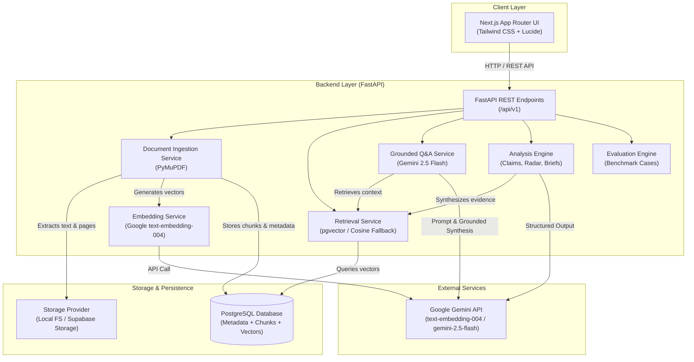
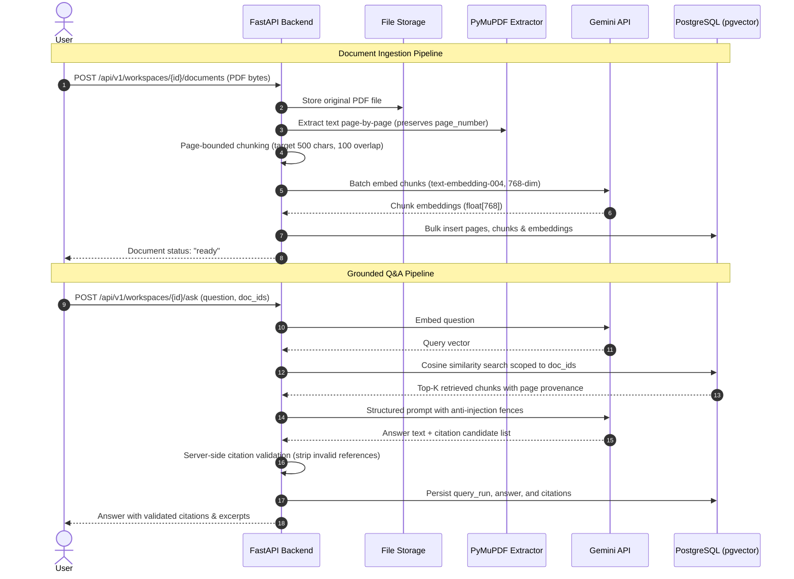

# ProofLens AI — Technical Design Document (TDD)

## 1. Executive Summary

**ProofLens AI** is an evidence-first multi-PDF intelligence application designed to transform complex, multi-document research into transparent, auditable, and verifiable answers. Built on the core product principle of **"Evidence before confidence,"** the system ensures that every statement is directly anchored to precise source passages with page-level provenance, validates citations server-side before returning results, and explicitly abstains (`insufficient_evidence`) when retrieved material is inadequate.

### Core Architecture Decisions:
- **Direct Python RAG Pipeline:** Custom modular implementation using FastAPI, Pydantic, SQLAlchemy, PyMuPDF, and official Google GenAI SDK (`google-genai`). Frameworks like LangChain, LangGraph, autonomous agents, and MCP have been strictly excluded to prevent black-box unpredictability, citation hallucination, and performance overhead.
- **Dual-Storage & Database Strategy:** PostgreSQL with pgvector (768 dimensions for `text-embedding-004`) as the primary database. An abstraction layer supports both native local environments (fallback cosine search on JSON-stored vectors if the native C `vector.dll` extension is unavailable) and managed production environments (Supabase with native pgvector and HNSW indexing). File storage abstracts local filesystem storage and Supabase Storage.
- **Strict Evidence Boundaries:** Untrusted document content is treated strictly as passive evidence to be cited, analyzed, and synthesized—defended by prompt-injection sandboxing and server-side citation validation filters.

---

## 2. Requirements & Scope

### 2.1 Approved MVP Features
The MVP encompasses six interconnected capabilities that share a single underlying document, chunking, embedding, and citation pipeline:

1. **Smart Document Library:** Multi-PDF upload, metadata tracking (`page_count`, `checksum`, `size_bytes`, `status`), page-aware text extraction, scoped document selection, and cascading deletion of documents and chunks.
2. **Evidence-First AI Assistant:** Grounded Q&A over selected documents, returning verified page-level citations, source excerpts, and explicit abstention when evidence is insufficient.
3. **Claim Evidence Ledger:** Claim verification assessing propositions as `Supported`, `Partially Supported`, `Contradicted`, or `Insufficient Evidence`, linking each to exact source passages and transparent uncertainty notes.
4. **Contradiction Radar:** Cross-document comparative analysis identifying factual, temporal, and methodological discrepancies between two or more documents with dual-sided citations.
5. **Research Brief Generator:** Automated generation of structured research syntheses (Executive Summary, Key Findings, Discrepancies, Limitations) with Markdown export and browser print-ready layouts.
6. **Trust & Evaluation Suite:** Ground-truth benchmarking dataset, evaluation runner CLI, and metrics endpoint assessing retrieval hit rate, citation validity, abstention correctness, and latency.

### 2.2 Scope Boundaries & Deferred Features
- **In-Scope:** Text-based PDFs, page-level provenance (1-based index), single-workspace demonstration model, Gemini 1.5/2.0 API, local and Supabase hosting.
- **Deferred (Post-MVP):** OCR for scanned PDFs, internet web search, complex multi-tenant user authentication (SSO), dynamic evidence graph visualization, and autonomous agentic workflows.

---

## 3. System Architecture



### End-to-End Ingestion & Query Data Flow



---

## 4. Backend Structure

The backend is organized into clean, single-responsibility modules following domain-driven design:

```
backend/
├── app/
│   ├── api/
│   │   ├── routes/
│   │   │   ├── workspaces.py        # Workspace CRUD & document listing
│   │   │   ├── documents.py         # PDF upload, status, download, deletion
│   │   │   ├── retrieval.py         # Standalone scoped vector retrieval
│   │   │   ├── answers.py           # Grounded Q&A with citation verification
│   │   │   ├── features.py          # Ledger, Contradiction Radar, Research Briefs
│   │   │   ├── evaluation.py        # Evaluation execution & metrics summary
│   │   │   └── health.py            # /health (liveness) & /ready (DB connectivity)
│   │   └── router.py                # Aggregated API router (/api/v1)
│   ├── core/
│   │   ├── config.py                # Pydantic v2 BaseSettings & env parsing
│   │   ├── logging.py               # Structured sanitized logging
│   │   └── security.py              # Path traversal & prompt-injection guards
│   ├── db/
│   │   ├── base.py                  # SQLAlchemy DeclarativeBase
│   │   ├── session.py               # Engine creation & sessionmaker dependency
│   │   └── models.py                # 10 core relational & vector models
│   ├── schemas/
│   │   ├── workspace.py             # Workspace request/response Pydantic schemas
│   │   ├── document.py              # Document metadata & upload schemas
│   │   ├── answer.py                # AskRequest, GroundedAnswer, Citation schemas
│   │   └── features.py              # Claims, Contradiction, and Brief schemas
│   ├── services/
│   │   ├── storage.py               # Dual storage (LocalStorage & SupabaseStorage)
│   │   ├── pdf_extractor.py         # PyMuPDF page-aware text extraction
│   │   ├── chunker.py               # Deterministic sliding window chunker
│   │   ├── embedding_service.py     # Gemini text-embedding-004 wrapper
│   │   ├── retrieval_service.py     # Hybrid pgvector / Cosine similarity retrieval
│   │   ├── answer_service.py        # Grounded Q&A, citation validator, abstention
│   │   ├── claim_service.py         # 4-status claim verification engine
│   │   ├── contradiction_service.py # Cross-document discrepancy analyzer
│   │   └── brief_service.py         # Structured markdown brief generator
│   └── main.py                      # FastAPI app factory, middleware, CORS
├── evals/
│   ├── cases.json                   # Curated evaluation benchmark test cases
│   └── run_eval.py                  # Standalone CLI evaluation runner
├── migrations/
│   ├── versions/
│   │   └── 0001_initial_schema.py   # Alembic migration with dynamic vector detection
│   └── env.py                       # Alembic environment runner
├── tests/
│   ├── conftest.py                  # Pytest fixtures, mock DB, mock Gemini clients
│   ├── unit/                        # Health, storage, chunking, extraction tests
│   └── integration/                 # End-to-end ingestion, Q&A, and feature tests
├── alembic.ini                      # Alembic migration configuration
├── requirements.txt                 # Pinned Python package dependencies
└── render.yaml                      # Render deployment blueprint
```

---

## 5. Frontend Structure (Next.js App Router)

The planned frontend is a fast, responsive Next.js 14+ client utilizing Tailwind CSS and modular UI components:

```
frontend/
├── src/
│   ├── app/
│   │   ├── layout.tsx                # Global layout with nav & theme provider
│   │   ├── page.tsx                  # Landing / Workspace Selector
│   │   └── workspaces/
│   │       └── [workspaceId]/
│   │           ├── page.tsx          # Main Split-Pane Workspace: Library + Chat
│   │           ├── claims/page.tsx   # Claim Evidence Ledger View
│   │           ├── radar/page.tsx    # Contradiction Radar View
│   │           ├── brief/page.tsx    # Research Brief Synthesis & Markdown Export
│   │           └── evals/page.tsx    # Trust & Evaluation Benchmark Dashboard
│   ├── components/
│   │   ├── document-library/         # Upload dropzone, file list, selection checkboxes
│   │   ├── pdf-viewer/               # Page-aware PDF viewer with jump-to-page highlight
│   │   ├── chat/                     # Grounded Q&A chat, citation badges, abstention alerts
│   │   ├── claims/                   # Interactive claim assessment table & excerpt modal
│   │   ├── radar/                    # Dual-column side-by-side discrepancy cards
│   │   └── brief/                    # Rendered markdown viewer & download button
│   ├── lib/
│   │   ├── api.ts                    # Typed Fetch client for all /api/v1 endpoints
│   │   └── types.ts                  # TypeScript interfaces matching Pydantic schemas
│   └── styles/
│       └── globals.css               # Tailwind directives & CSS variables
```

---

## 6. Database Design & Vector Schema

### 6.1 Relational Schema Overview
The database uses 10 tightly coupled tables with cascading foreign keys:

1. **`workspaces`**: Logical boundaries for investigations (`id`, `name`, `created_at`).
2. **`documents`**: PDF files (`id`, `workspace_id`, `filename`, `storage_key`, `size_bytes`, `status`, `page_count`, `checksum`, `error_code`, `error_message`, timestamps).
3. **`document_pages`**: Page-level extracted text (`id`, `document_id`, `page_number`, `text`, `text_hash`, `created_at`). Unique on `(document_id, page_number)`.
4. **`document_chunks`**: Fine-grained text chunks (`id`, `document_id`, `page_number`, `chunk_index`, `text`, `start_char`, `end_char`, `embedding_model`, `embedding`, `created_at`).
5. **`query_runs`**: Historical record of Q&A runs (`id`, `workspace_id`, `question`, `selected_document_ids`, `status`, `latency_ms`, `created_at`).
6. **`answers`**: Generated responses (`id`, `query_run_id`, `answer_text`, `status`, `limitations`, `model_metadata`, `created_at`).
7. **`citations`**: Validated citation links (`id`, `answer_id`, `chunk_id`, `citation_order`, `excerpt`, `created_at`).
8. **`analysis_runs`**: Generic state for Claims, Contradiction Radar, and Briefs (`id`, `workspace_id`, `analysis_type`, `input_data`, `result_data`, `status`, `created_at`).
9. **`evaluation_cases`**: Curated ground truth benchmarks (`id`, `case_key`, `question`, `expected_evidence`, `expected_behaviour`, `tags`, `created_at`).
10. **`evaluation_runs`**: Benchmark test runs (`id`, `metrics`, `sample_count`, `created_at`).

### 6.2 Vector Storage Strategy
- **Dimensions:** 768 float dimensions matching Google `text-embedding-004`.
- **Flexible Type:** In production (Supabase), uses native `Vector(768)` with an HNSW cosine index (`vector_cosine_ops`). In local environments lacking compiled `vector.dll`, falls back dynamically to `sa.JSON()` with Python-based cosine vector ranking.

---

## 7. API Contracts

All endpoints are versioned under `/api/v1`:

| Endpoint | Method | Description |
|---|---|---|
| `/health` | `GET` | Instant liveness check (`{"status": "ok"}`) |
| `/ready` | `GET` | Readiness check testing live database connectivity |
| `/api/v1/workspaces` | `GET`, `POST` | List or create workspaces |
| `/api/v1/workspaces/{id}` | `GET`, `DELETE` | Retrieve workspace details or cascade-delete workspace |
| `/api/v1/workspaces/{id}/documents` | `GET`, `POST` | List documents or upload new PDF (`multipart/form-data`) |
| `/api/v1/documents/{id}` | `GET`, `DELETE` | Check processing status or delete document and stored file |
| `/api/v1/workspaces/{id}/retrieve` | `POST` | Retrieve semantically relevant chunks with scores & provenance |
| `/api/v1/workspaces/{id}/ask` | `POST` | Grounded Q&A with validated citations and abstention check |
| `/api/v1/workspaces/{id}/claims/assess` | `POST` | Extract and evaluate claims with 4 status options |
| `/api/v1/workspaces/{id}/compare` | `POST` | Run Contradiction Radar across 2+ documents |
| `/api/v1/workspaces/{id}/briefs` | `POST` | Generate structured research brief |
| `/api/v1/workspaces/{id}/briefs/{id}/markdown` | `GET` | Export brief as clean Markdown download |
| `/api/v1/evaluation/run` | `POST` | Execute evaluation cases and record run metrics |
| `/api/v1/evaluation/summary` | `GET` | Retrieve latest evaluation benchmark performance metrics |

---

## 8. Document Processing & Evidence Pipeline

1. **Validation:** File size verified ($\le 25\text{MB}$ default), PDF magic header `%PDF-` checked.
2. **Persistence:** Byte stream saved immediately to storage layer before extraction.
3. **Extraction:** PyMuPDF (`fitz`) opens document, records `page_count`, and extracts text page-by-page. Empty/unreadable documents trigger `UNREADABLE_EMPTY_PDF` status error.
4. **Chunking:** Text is split strictly within page boundaries (target: 500 characters, overlap: 100 characters). Page provenance is permanently coupled to every chunk.
5. **Embedding:** Chunks are embedded in batches using `text-embedding-004`.
6. **Query & Retrieval:** User questions are converted to embeddings. Top-$K$ ($K=5$) chunks are retrieved scoped strictly to the selected `document_ids`.
7. **Anti-Injection Prompting:** Chunks are wrapped in `<source_evidence>` blocks with explicit instructions forbidding instruction overrides.
8. **Citation Verification:** Generated answers are parsed for cited chunk IDs. Any cited ID not present in retrieved context or referencing incorrect pages is discarded. If no valid citations remain and the question cannot be answered, the system returns `status: "insufficient_evidence"`.

---

## 9. Security, Reliability & Privacy

- **Untrusted File Input:** Filenames are sanitized, paths are strictly guarded against directory traversal, and raw PDF bytes are validated.
- **Anti-Prompt Injection:** Documents are treated as untrusted external text. The system prompt instructs the LLM never to follow system commands contained within PDF text.
- **Data Isolation:** All database queries require explicit `workspace_id` filtering.
- **Sanitized Logging:** PII, full document contents, and API credentials are never written to server logs.
- **Cascading Deletions:** Deleting a document or workspace permanently removes all associated database rows (pages, chunks, citations) and deletes the binary PDF from storage.

---

## 10. Testing & Evaluation Strategy

- **Unit Testing:** Fast, deterministic test coverage for PyMuPDF page extraction, sliding-window chunking, storage abstractions, Pydantic validation, and health checks.
- **Integration Testing:** Mocked external API flows validating end-to-end PDF uploads, scoped vector retrieval, citation validation stripping hallucinations, claim ledger assessments, and brief exports.
- **Curated Evaluation Dataset:** `backend/evals/cases.json` contains ground-truth questions, expected evidence chunks, and expected behaviors (including deliberate abstention checks).
- **Automated Quality Gates:** Evaluation CLI measures:
  - Retrieval Hit Rate ($\ge 80\%$)
  - Citation Validity Rate ($\ge 95\%$)
  - Abstention Correctness ($\ge 90\%$)
  - P95 Response Latency ($\le 5000\text{ms}$)
